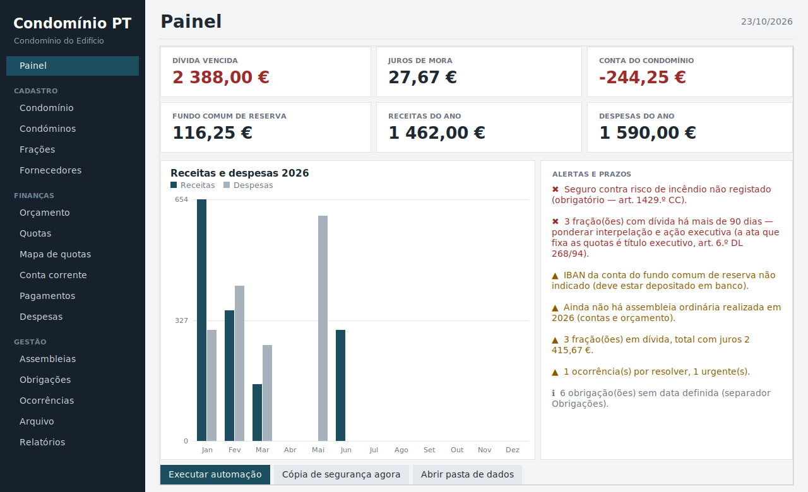
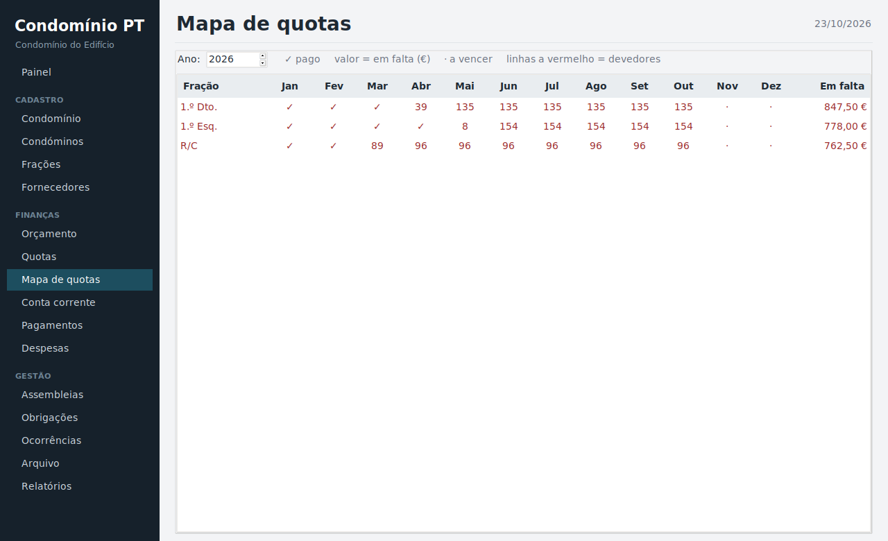
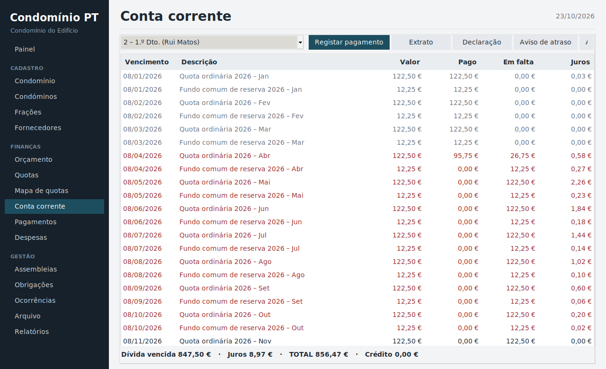

# Condomínio PT

Programa de **gestão de condomínios** em regime de propriedade horizontal, ajustado à legislação portuguesa. Corre em Windows como um único `.exe`, sem instalação, sem servidor e sem dependências externas. Os dados ficam no computador de quem o utiliza.

Escrito em Python (apenas biblioteca padrão: `tkinter` e `sqlite3`).



## Funcionalidades

**Cadastro**
- Condóminos, frações (permilagem, área, tipo) e fornecedores.
- Validação do total de permilagem (1000 ‰), do NIF e do IBAN português (dígito de controlo).

**Finanças**
- Orçamento anual por categoria, com cópia do ano anterior e atualização percentual.
- Geração automática das quotas do ano (mensal, trimestral, semestral ou anual), rateadas pela permilagem, com o **fundo comum de reserva** (mínimo de 10 %) calculado em separado.
- Quotas extraordinárias rateadas pela permilagem.
- Conta corrente por fração: os pagamentos são imputados às quotas mais antigas e os **juros de mora** são calculados em juro simples (dias/365).
- Pagamentos com **recibos numerados** (`R2026/0001`).
- Despesas com IVA, fornecedor e origem (ordinária, extraordinária ou fundo de reserva).
- Saldo da conta do condomínio e saldo do fundo de reserva, em separado.

**Gestão**
- Assembleias: convocatória (com aviso se o prazo for inferior ao mínimo), minuta de ata com presenças e envio da convocatória por email.
- Obrigações e manutenções periódicas, com datas e alertas.
- Ocorrências (avarias e pedidos) com prioridade, estado, fornecedor e custo.
- Arquivo digital de atas, contratos, apólices e faturas.

**Documentos e relatórios** (abrem no navegador; Imprimir → Guardar como PDF)
- Extrato de conta corrente, declaração de dívida ou de não dívida, aviso de atraso.
- Relatório de contas para a assembleia (receitas, despesas, orçamento vs. execução, saldos).
- Mapa de quotas, mapa de devedores e exportação para CSV.

**Automação**
- Ao abrir, gera as quotas do ano se já existir orçamento e faz uma cópia de segurança diária (mantém as últimas 30).
- Alertas: seguro de incêndio, IBAN do fundo, assembleia anual, dívidas com mais de 90 dias, obrigações a vencer, contratos de fornecedores e ocorrências urgentes.

**Segurança**
- Palavra-passe de acesso opcional (bloqueia a abertura do programa; **não cifra** o ficheiro de dados).
- A palavra-passe do email nunca é guardada: é pedida no momento do envio.

| Painel | Mapa de quotas | Conta corrente |
|---|---|---|
|  |  |  |

## Valores legais por omissão

Todos são editáveis no separador **Condomínio**.

| Parâmetro | Valor | Referência |
|---|---|---|
| Fundo comum de reserva | ≥ 10 % da quota | DL 268/94, art. 4.º (redação da Lei 8/2022) |
| Seguro contra risco de incêndio | obrigatório | Código Civil, art. 1429.º |
| Juros de mora | 4 % ao ano, juro simples | Portaria 291/2003 |
| Antecedência da convocatória | 10 dias | Código Civil, art. 1432.º |
| Declaração de dívida / não dívida | emitida em 10 dias | Lei 8/2022 |
| Ata que delibera as contribuições | título executivo | DL 268/94, art. 6.º |
| Rateio das despesas | pela permilagem (total 1000 ‰) | Código Civil, art. 1424.º |

> **Aviso:** esta é uma ferramenta de apoio e não substitui aconselhamento jurídico, contabilístico ou fiscal. Confirme prazos, taxas e textos legais em vigor antes de os usar em documentos oficiais. As taxas de juros e outras regras podem mudar.

## Como usar

### Opção 1 — Correr diretamente

```bash
py condominio.py
```

Requer Python 3.10 ou superior (em Linux, o pacote `python3-tk`).

### Opção 2 — Criar o `.exe` (Windows)

1. Instale o Python a partir de [python.org](https://www.python.org/downloads/) e marque *Add to PATH*.
2. Faça duplo clique em `build.bat`, que executa:

   ```bat
   py -m pip install --upgrade pyinstaller
   py -m PyInstaller --noconsole --onefile --name CondominioPT condominio.py
   ```
3. O executável fica em `dist\CondominioPT.exe`.

## Primeira utilização

1. **Condomínio:** nome, NIF, morada, administrador, IBANs, seguro e periodicidade das quotas.
2. **Condóminos** e **Frações** (a permilagem total tem de ser 1000 ‰).
3. **Orçamento** do ano → **Gerar quotas do ano**.
4. Registar **Pagamentos** (e emitir recibos) e **Despesas**.
5. Consultar o **Painel**, o **Mapa de quotas** e os **Relatórios**.

## Dados e cópias de segurança

Os dados ficam em `C:\Users\<utilizador>\CondominioPT\` (ou `~/CondominioPT` noutros sistemas), ou na pasta indicada pela variável de ambiente `CONDOMINIO_DIR`:

```
CondominioPT/
├── condominio.db      base de dados SQLite
├── docs/              documentos gerados (HTML)
├── arquivo/           arquivo digital
└── backups/           cópias diárias automáticas
```

Para fazer uma cópia manual, copie a pasta. Para repor, substitua `condominio.db`.

## Estrutura do projeto

```
condominio.py   aplicação completa (lógica financeira, documentos e interface)
build.bat       criação do .exe com PyInstaller
LEIAME.txt      instruções resumidas
docs/           capturas de ecrã
```

O código está organizado em três blocos no mesmo ficheiro: base de dados e motor financeiro (`alocar`, `resumo`, `gerar_quotas`, `alertas`), geração de documentos HTML e interface `tkinter`.

## Limitações

- Aplicação local para um só utilizador, sem acesso web ou móvel para os condóminos.
- Juros calculados com uma única taxa configurável, sem histórico de alterações da taxa legal.
- Sem retenções na fonte, sem comunicação de faturas à AT e sem pagamentos por referência Multibanco.
- Os recibos são documentos internos e não são certificados pela AT.

## Contribuir

Sugestões e *pull requests* são bem-vindos. Ao reportar um problema, indique o sistema operativo, a versão do Python e os passos para o reproduzir (sem dados pessoais reais).


